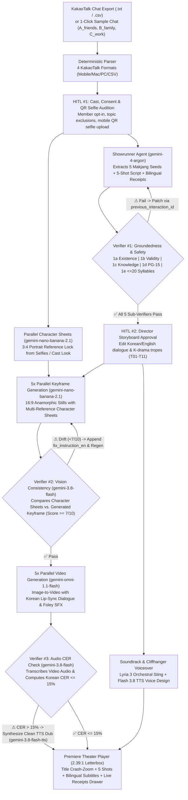

# 막장 (MAKJANG) — Your Group Chat, Remade as a K-Drama

> **Live Demo (Google Cloud Run, `asia-northeast3`)**: [https://makjang-3116986546.asia-northeast3.run.app](https://makjang-3116986546.asia-northeast3.run.app)  
> **Judge Demo Passcode**: `makjang`

**Makjang** turns everyday KakaoTalk group-chat exports (`.txt` / `.csv`) into an over-the-top, broadcast-grade **60-second Korean makjang drama trailer** (*The Penthouse*, *Temptation of Wife*, *Love & War* style)—complete with **torn-paper chat receipts** (`RECEIPT #line_id`) proving that every single plot twist, secret, and accusation is grounded in a real message from your group chat.

Every generated trailer shot and chat receipt is **fully bilingual (Korean + natural English subtitles/translations)** so both Korean and international judges can follow every dramatic betrayal and verify every chat citation.

---

## 1. End-to-End Architecture & Autonomous Verification Loops



---

## 2. Six Google DeepMind Models Orchestrated via `@google/genai` Interactions API

| Stage | Model ID | Role in Makjang |
| :--- | :--- | :--- |
| **Showrunner & Self-Patching** | `gemini-4-argon` | Reads 900+ lines of raw KakaoTalk logs (`thinking_level: "medium"`), mines 5 suspicious contradictions (`seeds`), casts members into K-drama archetypes, writes the 5-shot script (`line_ko`, `line_en`, `receipts`), and self-corrects via multi-turn `previous_interaction_id` when Verifier #1 flags an issue. |
| **Verifier #1 (Validity, Knowledge & Safety)** | `gemini-4-argon-lite` | Runs in parallel across all 5 shots to verify citation validity (`v1_validity`), speaker epistemic knowledge (`v1_knowledge`), and PG-15 K-drama slapstick safety (`v1_safety`). |
| **Character Sheets & 16:9 Keyframes** | `gemini-nano-banana-2.1` | Generates `3:4` actor reference sheets in parallel with Argon (using uploaded/QR selfies or cast descriptions), then renders `16:9` widescreen keyframes with up to 3 character sheets passed as multi-image reference locks. |
| **Verifier #2 (Vision) & Verifier #3 (STT)** | `gemini-3.8-flash` | **Verifier #2**: Multimodal comparison of character reference sheets against generated keyframes (`score >= 7/10`), emitting `fix_instruction_en` on wardrobe/hair drift. **Verifier #3**: Transcribes spoken Korean dialogue from generated `.mp4` videos to compute Character Error Rate (CER). |
| **5× Parallel Video Generation** | `gemini-omni-1.1-flash` | Animates all 5 verified `16:9` keyframes concurrently (`<FIRST_FRAME>` image-to-video) with K-drama camera moves (`shock_zoom`, `slapstick_water`, `two_shot_confrontation`), Korean lip-sync dialogue, and foley SFX. |
| **Voice Design Narrator & Clean Dubs** | `gemini-3.8-flash-tts` | Creates a custom prompted baritone K-drama preview narrator via `ai.voices.create` for the cliffhanger ending (`"다음 이 시간…"`), and synthesizes crystal-clear Korean dialogue dubs whenever Verifier #3 detects `CER > 15%`. |
| **Makjang Orchestral Score** | `lyria-3-clip-preview` | Generates a custom 30-second minor-key orchestral makjang trailer sting (pizzicato strings, brass & timpani hits at 128 BPM). |

---

## 3. Three Autonomous Verification & Self-Correction Loops (`⚠ → ✅`)

1. **Verifier #1 — Script Groundedness, Epistemic Knowledge & Syllable Budget**:
   - **1a (`v1_existence`)**: Deterministic check that every cited `evidence` line ID exists in the parsed KakaoTalk log and does not belong to an excluded member.
   - **1b (`v1_validity`)**: `gemini-4-argon-lite` verifies that the cited KakaoTalk lines genuinely support the shot's accusation/conflict.
   - **1c (`v1_knowledge`)**: `gemini-4-argon-lite` verifies that the speaking character could plausibly know or suspect the information from the group chat.
   - **1d (`v1_safety`)**: Ensures PG-15 K-drama slapstick safety (water glass splash `T01`, kimchi slap `T02`, juice spit-take `T03`, envelope slam `T04`, triple crash-zoom `T08`—no weapons, gore, or real brand logos).
   - **1e (`v1_syllables`)**: Enforces `<= 20` Korean syllables (`/[가-힣]/g`) and modern conversational endings so every line fits comfortably inside a 4–8s video shot.
   - **Self-Correction**: Any failure triggers an automatic multi-turn patch call to `gemini-4-argon` (`previous_interaction_id`), logging the `⚠ → ✅` transition live in the Writers' Room SSE stream.

2. **Verifier #2 — Character Consistency Vision Check (`v2_vision`)**:
   - Before any video is rendered, `gemini-3.8-flash` inspects the character reference sheets alongside the generated `16:9` keyframe.
   - If hair color, glasses, or signature wardrobe drift (`score < 7/10`), it automatically appends `CRITICAL CORRECTION: <fix_instruction_en>` and regenerates the keyframe via `gemini-nano-banana-2.1` (`⚠ → ✅`).

3. **Verifier #3 — Korean Dialogue CER & Automatic TTS Dubbing (`v3_audio`)**:
   - After `gemini-omni-1.1-flash` renders each `.mp4` shot, `gemini-3.8-flash` transcribes the spoken Korean audio track and computes normalized Levenshtein Character Error Rate (CER) against `shot.line_ko`.
   - If `CER > 15%`, Makjang automatically synthesizes a clean emotional Korean dialogue track with `gemini-3.8-flash-tts` (`⚠ → ✅`) and synchronizes it in the Premiere player.

---

## 4. Two Human-in-the-Loop (HITL) Checkpoints

- **HITL #1 — Cast, Consent & Live QR Selfie Audition**:
  - Toggle individual chat members in/out (excluded members are stripped from prompts and blocked by Verifier #1a).
  - Exclude sensitive topics (`음주/술자리`, `금전/정산`, `연애/전애인`, `외모/다이어트`, `퇴사/뒷담화`).
  - Scan a per-member QR code (`/audition/[runId]/[member]`) on any phone to snap a selfie that streams live via SSE (`audition_selfie`) into the casting board, or use the pre-attached sample selfies (`data/selfies/{A,B,C}_*.jpg`).
- **HITL #2 — Director Storyboard & Trope Override**:
  - Review the verified 5-shot script, edit Korean dialogue (`line_ko` with live 20-syllable counter) or English subtitles (`line_en`), and swap K-drama tropes (`T01`–`T11`) before firing the 5× parallel video shoot.

---

## 5. Local Development & Cloud Run Deployment

### Prerequisites
- Node.js 20+
- `ffmpeg` installed (`apt-get install ffmpeg` or `brew install ffmpeg`)
- `GEMINI_API_KEY` with access to `@google/genai` Interactions API

### Run Locally
```bash
npm install
cat <<EOF > .env.local
GEMINI_API_KEY=your_api_key_here
DEMO_PASSCODE=makjang
QUALITY=draft
EOF
npm run dev
```

### Deploy to Google Cloud Run
```bash
gcloud run deploy makjang \
  --source . \
  --region asia-northeast3 \
  --allow-unauthenticated \
  --no-cpu-throttling \
  --min-instances 1 \
  --max-instances 1 \
  --timeout 900 \
  --memory 2Gi \
  --set-env-vars "GEMINI_API_KEY=$(cat ~/.hack-key | tr -d '[:space:]'),DEMO_PASSCODE=makjang,QUALITY=draft"
```
